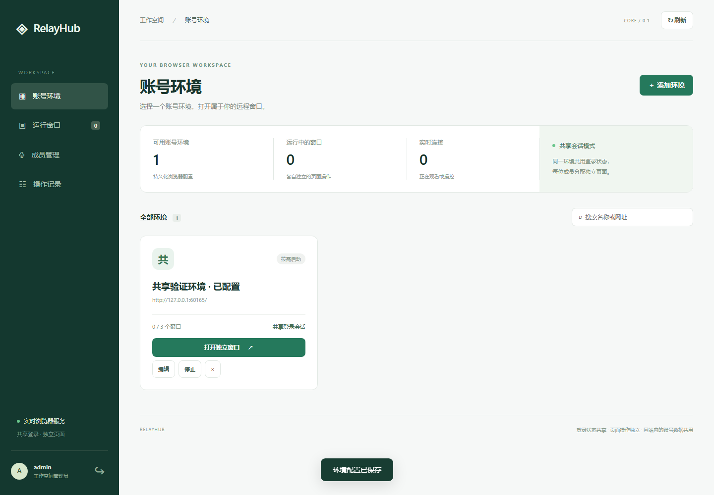
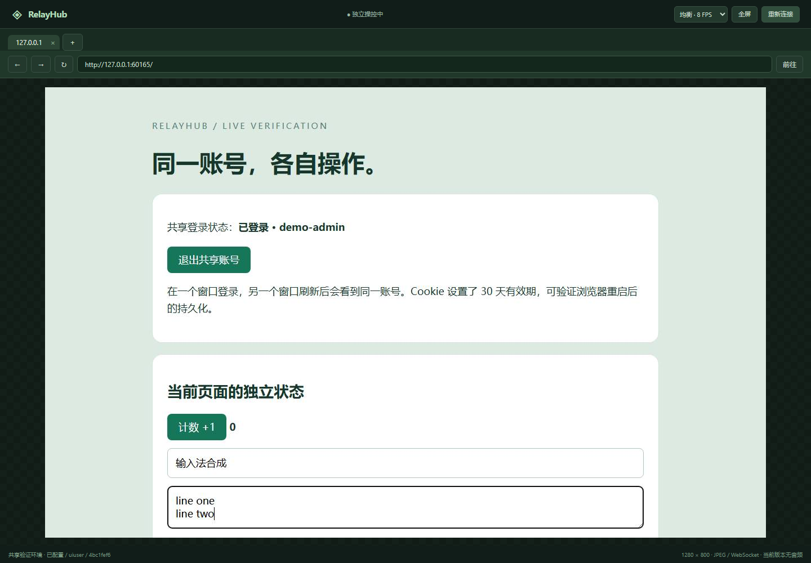
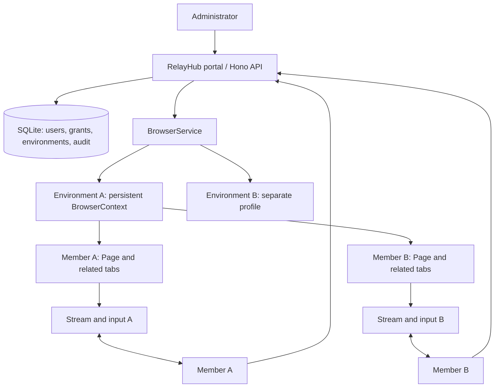

<div align="center">
  
  <h1>RelayHub</h1>
  <p><strong>Sign in once. Give everyone their own remote page.</strong></p>
  <p><strong>English</strong> · <a href="README.md">简体中文</a></p>
  <p>
    
    = 24">
    
    
  </p>
  <p>
    <a href="#quick-start">Quick start</a> ·
    <a href="#preview">Preview</a> ·
    <a href="#how-it-works">How it works</a> ·
    <a href="#deployment">Deployment</a> ·
    <a href="docs/VERIFICATION.md">Verification</a> ·
    <a href="#roadmap">Roadmap</a>
  </p>
</div>

**RelayHub is a self-hosted workspace for multi-user remote browsing.** An administrator signs in to a website in a server-side browser and grants members access to that account environment. Each member opens their own remote page in RelayHub, using the original website interface.

Pages in the same environment share website login state. Navigation, mouse and keyboard input, and screen streams are routed separately for each member. Administrators can observe sessions, take control, and release resources.

```text
One account environment → One persistent BrowserContext → Separate Pages → Multiple members
```

The current implementation runs real Chromium and includes screen streaming, remote input, member management, permissions, and automated browser tests. It uses JPEG over WebSocket and **does not transmit audio**. Separate pages still use the same website account: history, files, permissions, settings, and quotas may be shared.

<a id="quick-start"></a>
## Quick start

Install **Node.js 24 or later**, npm, and Git. Run in Windows PowerShell, macOS, or Linux:

```bash
git clone https://github.com/xieguu/share-account-set.git
cd share-account-set
npm ci
npm run setup
npx playwright install chromium
npm run dev
```

Open **[http://127.0.0.1:3410](http://127.0.0.1:3410)**.

Setup creates a local `.env` with a random administrator password and preserves any existing configuration. Use `RELAY_ADMIN_USER` and `RELAY_ADMIN_PASSWORD` to sign in. These credentials initialize the database only; editing `.env` later does not reset an existing password. The application interface is currently in Simplified Chinese.

On Linux, install missing browser system dependencies with:

```bash
npx playwright install --with-deps chromium
```

### Verify shared login and separate input

The default configuration enables a local verification website:

1. Sign in as the RelayHub administrator and open the built-in account environment.
2. Click the test-account login button inside the remote page.
3. Create two members under member management and grant access to that environment.
4. Sign in as each member using separate local browser profiles or different browsers, then open their remote windows.
5. Both pages recognize `demo-admin`. Type different text, increment counters, navigate, and open popups to verify that page operations remain separate.

Two ordinary local tabs share the portal's login cookie and cannot represent two different members. The administrator's remote window also counts toward the environment's session limit.

<a id="preview"></a>
## Preview

These screenshots come from real browser UI tests. The remote content is the built-in verification site; random ports in screenshots belong to the test runtime. The default application port is `3410`.

**Account environments and management**



**A member's remote window**



## What works today

| Capability | Implementation |
| --- | --- |
| Account environments | Name, start URL, allowed origins, and concurrency limits; browsers start on demand |
| Persistent shared login | One dedicated browser profile per environment, reused across its member pages |
| Separate member sessions | One window per member per environment, with up to five related tabs |
| Remote interaction | Mouse, wheel, keyboard, Chinese IME, text paste, back, forward, and reload |
| Popups and tabs | New website pages belong to the member window that opened them |
| Screen streaming | 1280 × 800 JPEG, three quality profiles, received FPS, heartbeat latency, and data-rate display |
| Reconnection | Up to five automatic attempts after temporary disconnects, plus manual reconnect |
| Administration | Read-only observation, control revocation, takeover, window release, environment stop and edit |
| Member access | Create members, assign or revoke environments, disable accounts |
| Resource cleanup | Disconnected windows expire after 15 minutes by default; unused environments are also reclaimed |
| Audit trail | Portal login, access changes, control actions, and window lifecycle events |

Reconnection retains page state only while the server-side session remains alive. Revoking environment access closes the member's associated windows.

### Streaming and input improvements

| Profile | Target capture frequency | JPEG quality |
| --- | ---: | ---: |
| `economy` | 4 FPS | 50 |
| `balanced` (default) | 8 FPS | 70 |
| `smooth` | 15 FPS | 80 |

These are capture settings, not guaranteed delivery rates. Actual FPS depends on page changes, rendering load, network conditions, and decoding speed.

- Identical captures are suppressed, with a refresh opportunity approximately every two seconds. Capture still runs to detect changes.
- Viewers acknowledge decoded frames. During normal streaming, each connection has at most one frame awaiting acknowledgment; a slow viewer does not accumulate an unbounded frame queue.
- Capture pauses when no viewer is visible. An active administrator observer keeps streaming alive.
- Each remote window orders its own operations. Frame acknowledgments and heartbeat messages bypass slow navigation.
- The bundled client includes the displayed tab ID with input. Stale-target input is rejected, and late decoding from a disconnected socket cannot hide the disconnect screen.

See [frame-stream.ts](src/frame-stream.ts), [browser.ts](src/browser.ts), and [viewer.js](public/viewer.js).

<a id="how-it-works"></a>
## How it works



An **environment** owns a website account's browser profile. A **member window** is a group of pages assigned to one RelayHub user. A **tab** is a Playwright `Page`. Windows in the same environment share one persistent `BrowserContext`.

| State | Behavior within one environment |
| --- | --- |
| Navigation, form input, scroll position | Separate page operations, except data synchronized by the website itself |
| Screen and input channels | Routed per member window |
| Cookies, LocalStorage, IndexedDB | Shared for the same origin; SessionStorage follows browser page semantics |
| Website permissions and server-side data | Belong to the shared account |
| RelayHub login and grants | Independently authenticated and checked per member |

Portal authentication uses HttpOnly cookies, scrypt-derived passwords, and hashed login tokens. Logout revokes the current login's connections; disabling a member revokes their logins and closes their windows. Audit records do not contain keyboard content or captured frames. Browser profiles still contain the website's own storage and caches.

The current stack is **TypeScript, Hono, SQLite, Playwright/CDP, and a vanilla web frontend**. PostgreSQL, Redis, and a separate frontend build service are not required.

## Connect a website

Create an environment with a start URL, session limit, and the exact origins the website needs:

```text
https://app.example.com
https://login.example.com
https://cdn.example.com
https://api.example.com
```

Open a remote window, sign in to the website, and grant members access. Origins use exact `scheme://host[:port]` matching; wildcards are not supported. Include login redirects, resource hosts, API origins, and WebSocket origins. Configure `https://` for `wss://` and `http://` for `ws://`.

Unlisted requests are blocked, and service workers are disabled. Missing assets or failed login redirects require checking the site's dependencies and origin list. This request policy does not replace network-level egress controls.

**Editing an environment closes its existing windows.** New windows use the updated settings, while its ID, grants, and profile directory remain intact. Stopping an environment also preserves website storage.

## Configuration and persistence

Setup derives `.env` from [.env.example](.env.example).

| Variable | Default / purpose |
| --- | --- |
| `RELAY_HOST` | `127.0.0.1`; Compose overrides it to `0.0.0.0` inside the container |
| `RELAY_PORT` | `3410` |
| `RELAY_ORIGIN` | `http://127.0.0.1:3410`; must match the browser's actual portal origin |
| `RELAY_DATA_DIR` | `./data` |
| `RELAY_ADMIN_USER` | `admin`; initial database setup only |
| `RELAY_ADMIN_PASSWORD` | Randomly generated by setup; minimum 12 characters; initialization only |
| `RELAY_HEADLESS` | `true`; use `false` for local visible-browser debugging |
| `RELAY_BROWSER_CHANNEL` | Empty for bundled Chromium; explicitly select installed `msedge` or `chrome` |
| `RELAY_MAX_CONTEXTS` | `6` concurrent running environments |
| `RELAY_IDLE_MINUTES` | `15`; cleanup interval threshold, not an online usage limit |
| `RELAY_LAB` | `true` in the example configuration; enables the local test site |
| `RELAY_LAB_PORT` | `3411` |
| `RELAY_DOMAIN` | HTTPS Compose only, for example `relay.example.com` |

HTTP writes and WebSocket upgrades check `RELAY_ORIGIN`. Different hostnames, ports, and schemes are different origins, including `localhost` versus `127.0.0.1`. Update the configuration and restart when changing the access URL.

```text
data/
├── relayhub.sqlite
└── profiles/
    └── <environment-id>/
```

Stop the service before backing up the complete data directory and deployment configuration. Restarting the browser retains persistent website storage, **not unsaved forms or the previous tab set**. Website login expiration still applies.

Deleting an environment removes its configuration and grants but preserves its on-disk profile. There is currently no automatic reattachment interface for that retained profile.

<a id="deployment"></a>
## Build and deploy

After installing dependencies and Chromium:

```bash
npm run check
npm run build
npm start
```

Start from the repository root. `npm start` reads `.env`.

```bash
curl http://127.0.0.1:3410/api/health
# {"status":"ok","version":"0.1.0"}
```

### Docker Compose

A [Dockerfile](Dockerfile) and [Compose configuration](compose.yaml) are included. With `.env` already generated:

```bash
docker compose up -d --build
docker compose logs -f relayhub
```

On a Docker-only host, copy `.env.example` to `.env` and replace `RELAY_ADMIN_PASSWORD` with a random password of at least 12 characters first. The image installs the matching Chromium version; host Node.js is unnecessary.

Compose publishes only `127.0.0.1:3410` and persists data in its `relayhub-data` named volume. The initial configuration sets a 4 GB memory limit and 1 GB shared memory. These are configuration values, not measured capacity claims.

### HTTPS

Point a domain at the server, allow incoming ports 80/443, and set:

```dotenv
RELAY_DOMAIN=relay.example.com
RELAY_ORIGIN=https://relay.example.com
RELAY_LAB=false
```

```bash
docker compose -f compose.yaml -f compose.https.yaml up -d --build
```

[Caddy](Caddyfile) handles HTTPS and WebSocket proxying. Keep internal port `3410`, or update Compose mappings, health checks, and the Caddy upstream together.

Run **one application instance**. A profile cannot be opened by multiple Chromium instances concurrently, and horizontal scaling is not implemented. Docker, Ubuntu, and public HTTPS configuration have not been validated in the current test environment.

## Verification

```bash
npm run check
npm test
npm run build
```

The 2026-10-17 local Windows run with Node.js 24.14.0 and Playwright 1.61.1 reported **17 passed, 0 failed**. Tests use real Chromium, a separate-origin website, and real WebSocket connections.

Coverage includes shared login and persistent storage; independent input, navigation, frames, and popups; ownership and access checks; control revocation; logout; cleanup; frame suppression and acknowledgment; visibility and quality settings; heartbeats during slow navigation; stale-input rejection; manual and automatic reconnection; late decoded frames after disconnection; management forms; Chinese IME; shortcuts; multiline input; and mobile portal layout.

See [docs/VERIFICATION.md](docs/VERIFICATION.md) for scope and artifact locations. Third-party website compatibility, public-network behavior, and sustained capacity require separate measurements.

## Current boundaries

| Area | Current behavior |
| --- | --- |
| Audio / WebRTC | Not implemented; video pages are visible through JPEG frames only |
| Uploads / downloads | Not integrated; downloads are canceled and uploads display a notice |
| Clipboard | Local text can be pasted remotely; remote clipboard reading is unavailable |
| Website JS dialogs | Message is displayed, then the dialog is dismissed |
| Authentication popups | Associated with their originating window; site compatibility still needs verification |
| Restart recovery | Persistent website storage is kept; in-memory sessions and forms are not restored |
| Account data | Shared environments do not isolate data inside the third-party account |
| Scaling | No multi-node scheduler, cross-process session routing, or persistent job queue |

<a id="roadmap"></a>
## Roadmap

- [x] Shared persistent context and separate member pages
- [x] Real frames, directed input, and associated popups
- [x] Portal authentication, grants, observation, and takeover
- [x] Flow control, quality selection, visibility pause, and reconnection
- [x] Environment editing, resource cleanup, and automated verification
- [ ] Docker, Ubuntu, and public HTTPS deployment validation
- [ ] Real-site compatibility and concurrency measurements
- [ ] File channels, website dialogs, and richer clipboard interaction
- [ ] Per-page audio capture and WebRTC validation
- [ ] Page recovery, multi-node scheduling, and an external database

Unchecked items are future work, without delivery dates.

## Development

| Path | Responsibility |
| --- | --- |
| [src/app.ts](src/app.ts) | HTTP API, authentication, authorization, WebSocket connections |
| [src/browser.ts](src/browser.ts) | Environments, sessions, tabs, input ordering, cleanup |
| [src/frame-stream.ts](src/frame-stream.ts) | Capture, deduplication, acknowledgments, backpressure |
| [src/store.ts](src/store.ts) | SQLite, members, grants, login sessions, audit |
| [src/protocol.ts](src/protocol.ts) | Control-message schemas and origin matching |
| [public/](public/) | Management portal and remote client |
| [src/lab.ts](src/lab.ts) | Separate-origin verification site |
| [tests/](tests/) | Browser integration and UI tests |

An existing frontend can use `/api/environments`, `/api/sessions`, and `/ws/sessions/:id`. WebSocket authentication uses the same-origin portal cookie. Each frame has a JSON header followed by binary JPEG data; the client sends `frame_ack` after processing. See [protocol.ts](src/protocol.ts) and [viewer.js](public/viewer.js) for the current contract.

## Feedback and contributions

Submit reproducible [issues](https://github.com/xieguu/share-account-set/issues) and pull requests. Include the operating system, Node.js version, browser channel, reproduction steps, expected result, and observed result. Redacted origin configuration helps with compatibility reports; omit `.env`, login cookies, and browser profiles.

Read the affected module and existing tests, reuse established dependencies, and run `npm run check`, `npm test`, and `npm run build` before submitting. UI screenshots can be regenerated with `tests/ui.test.ts`.

## References and licensing

Remote input code is adapted from [yvonuk/remotebrowser](https://github.com/yvonuk/remotebrowser), with its MIT license retained and changes to keyboard dispatch documented.

Design references include [gpt-set](https://github.com/xieguu/gpt-set) for persistent sessions and multiple windows, [url-set](https://github.com/amsasw/url-set) for navigation and popup association, and [chatgpt-web-share](https://github.com/Rextrad/chatgpt-web-share) for portal member management. No source code from these three reference projects was copied.

See [THIRD_PARTY_NOTICES.md](THIRD_PARTY_NOTICES.md) for provenance and changes. **A project-level license has not yet been declared.** Third-party components retain their own licenses, including [the vendored MIT license](src/vendor/remotebrowser/LICENSE).
