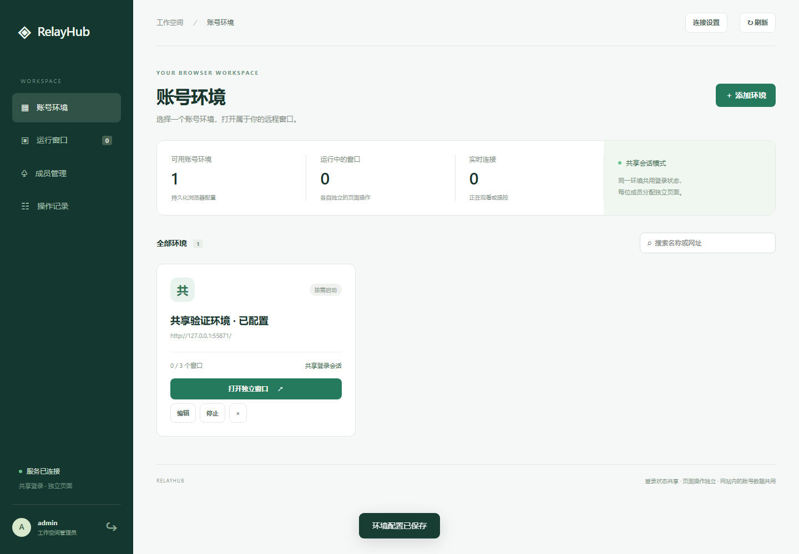
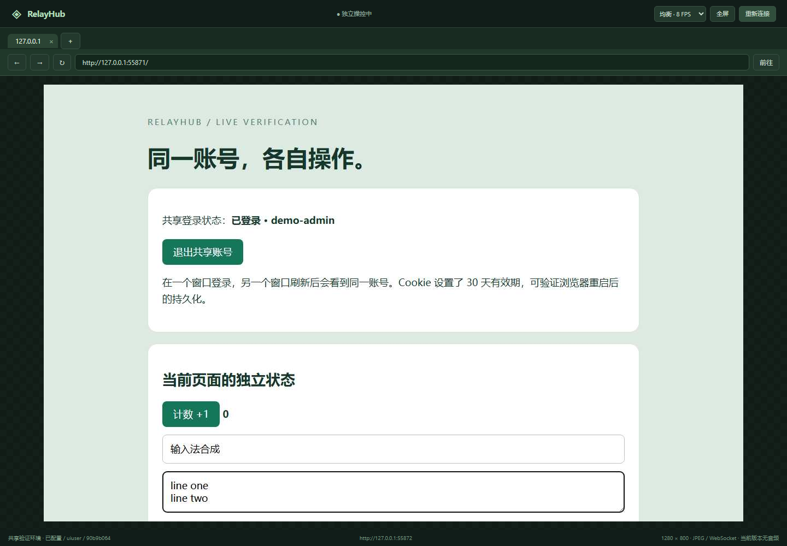
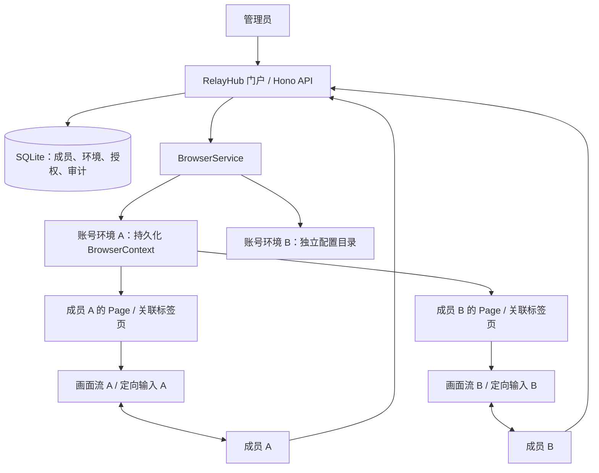

<div align="center">
  
  <h1>RelayHub</h1>
  <p><strong>登录一次，每个人操作自己的远程页面。</strong></p>
  <p><a href="README.en.md">English</a> · <strong>简体中文</strong></p>
  <p>
    
    = 24">
    
    
  </p>
  <p>
    <a href="https://xieguu.github.io/share-account-set/app/">在线工作台</a> ·
    <a href="#quick-start">快速开始</a> ·
    <a href="#preview">界面预览</a> ·
    <a href="#how-it-works">工作原理</a> ·
    <a href="#deployment">部署</a> ·
    <a href="docs/VERIFICATION.md">验证记录</a> ·
    <a href="#roadmap">路线图</a>
  </p>
</div>

此为 `page` 分支，包含可连接独立后端的 Pages 工作台。根目录是项目介绍，`/app/` 是实际操作入口；部署方式见 [Pages 运维说明](docs/PAGES.md)。

**RelayHub 是一个可自托管的多用户远程浏览器工作台。** 管理员在服务器浏览器中登录网站，为成员分配账号环境；成员打开 RelayHub，就能在网页里操作各自的远程页面，保留原网站的界面与交互。

同一账号环境中的页面共享登录状态，导航、键盘、鼠标与画面通道分别管理。你可以在一个页面搜索，另一名成员同时在自己的页面填写表单，管理员统一查看和回收窗口。

```text
一个账号环境 → 一个持久化 BrowserContext → 多个独立 Page → 多名成员
```

当前版本已接通真实 Chromium、画面传输和远程输入，附带成员管理、权限分配与自动化验证。画面使用 JPEG / WebSocket，**暂不传输音频**。独立页面仍使用同一个网站账号，因此网站内的历史、文件、权限、设置和额度可能共享。

<a id="quick-start"></a>
## 快速开始

需要 **Node.js 24 或更高版本**、npm 和 Git。在 Windows PowerShell、macOS 或 Linux 终端中执行：

```bash
git clone -b page https://github.com/xieguu/share-account-set.git
cd share-account-set
npm ci
npm run setup
npx playwright install chromium
npm run dev
```

打开 **[http://127.0.0.1:3410](http://127.0.0.1:3410)**。

`npm run setup` 生成本地 `.env` 和随机管理员密码；已有配置会保留。查看其中的 `RELAY_ADMIN_USER`、`RELAY_ADMIN_PASSWORD`，登录工作台。管理员凭据仅在首次初始化数据库时使用，之后修改 `.env` 不会重置已有账号密码。

Linux 如果缺少 Chromium 系统依赖，将浏览器安装命令替换为：

```bash
npx playwright install --with-deps chromium
```

### 先验证“共享登录，各自操作”

默认配置启用本地“共享会话验证站”，可以直接验证整个链路：

1. 管理员登录 RelayHub，打开“共享会话验证站”的独立窗口。
2. 在远程画面内点击“管理员登录测试账号”。
3. 回到工作台，在“成员管理”创建两名成员，并授予该环境的访问权限。
4. 使用两个独立浏览器配置文件或不同浏览器分别登录成员账号，各自打开窗口。
5. 两个页面都会看到 `demo-admin` 已登录；分别输入文字、点击计数、导航和打开弹窗，观察操作只影响所属页面。

同域部署的普通标签页会共用 RelayHub 门户 Cookie；验证多成员时使用独立浏览器配置。Pages 模式的登录保存在每个标签页的会话存储中。管理员的远程窗口也计入环境的并发上限。

### 使用 Pages 工作台

后端需要运行此 `page` 分支。将后端部署到自己的 HTTPS 地址，并设置：

```dotenv
RELAY_ORIGIN=https://relay.example.com
RELAY_FRONTEND_ORIGINS=https://xieguu.github.io
```

重启后端后，打开 [在线工作台](https://xieguu.github.io/share-account-set/app/)，点击“设置服务”，填写 `https://relay.example.com`。连接检查通过后，用该后端的 RelayHub 成员账号登录，即可管理环境、打开和操控自己的窗口。

Pages 提供前端，API 和 WebSocket 连接上述后端。成员与配置写入后端 SQLite，网站登录状态保存在后端 Chromium profile。未配置服务时会明确显示未连接；当前仓库不提供默认公共后端。详细部署、登录机制与排错见 [docs/PAGES.md](docs/PAGES.md)。

<a id="preview"></a>
## 界面预览

以下截图由真实浏览器界面测试生成，远程画面来自项目内置验证站。截图中的随机端口属于测试环境；默认启动端口为 `3410`。

**账号环境与工作台**



**成员的独立远程窗口**



## 已经可以做什么

| 能力 | 当前实现 |
| --- | --- |
| 多账号环境 | 分别配置名称、起始地址、允许来源和并发上限；按需启动 Chromium |
| 共享持久化登录 | 同一环境的页面共用浏览器配置目录；正常关闭后保留网站存储 |
| 成员独立操作 | 每名成员在每个环境最多拥有一个窗口；每个窗口最多 5 个关联标签页 |
| 原始网页交互 | 鼠标、滚轮、键盘、中文输入法、粘贴文本、前进、后退和刷新 |
| 弹窗与标签页 | 网页新开的标签页归属发起它的成员窗口，可切换或关闭 |
| 画面传输 | 1280 × 800 JPEG，三档画质，显示接收帧率、心跳延迟与数据速率 |
| 连接恢复 | 临时断线最多自动重试 5 次，也可手动重连；服务端页面仍存活时保留页面状态 |
| 管理员控制 | 只读观察、收回操控权、接管、释放窗口、停止或编辑环境 |
| 成员权限 | 创建成员、分配或撤销环境权限、停用账号；撤销权限会关闭对应窗口 |
| 资源回收 | 无连接窗口默认保留 15 分钟；无窗口环境闲置后关闭浏览器 |
| 操作记录 | 记录登录、授权、控制权和窗口生命周期操作 |
| Pages 工作台 | 配置独立后端、检查连接、跨域登录、远程窗口；同域模式继续使用 Cookie |

### 画面与输入优化

| 模式 | 目标捕获频率 | JPEG 质量参数 |
| --- | ---: | ---: |
| 省流 `economy` | 4 FPS | 50 |
| 均衡 `balanced`（默认） | 8 FPS | 70 |
| 流畅 `smooth` | 15 FPS | 80 |

这些是捕获配置，实际接收帧率取决于网页变化、渲染负载、网络和客户端解码速度。

- **静止画面减少传输**：比较捕获结果，相同 JPEG 不重复发送；约每 2 秒保留一次刷新机会。仍需要捕获才能判断画面是否变化。
- **慢客户端独立流控**：客户端解码后确认帧序号；正常情况下每个观看连接最多等待一帧确认，避免持续积压画面。
- **后台暂停**：窗口没有可见观看者时暂停捕获，重新可见后恢复；管理员正在观察时仍会继续传输。
- **输入按窗口排序**：操作在所属窗口的队列执行，画面确认和心跳不等待慢导航。
- **页面切换校验**：官方客户端携带当前画面的页面 ID，服务器拒绝发给旧页面的输入；旧连接的解码结果不会覆盖断线提示。

实现入口：[画面流](src/frame-stream.ts)、[浏览器会话](src/browser.ts)、[远程客户端](public/viewer.js)。验证方式见 [验证记录](docs/VERIFICATION.md)。

<a id="how-it-works"></a>
## 它如何工作



“账号环境”保存一个网站账号的浏览器状态；“成员窗口”表示分配给某个 RelayHub 用户的一组页面；“标签页”对应 Playwright 的 `Page`。多个窗口使用同一个环境时，共用同一个持久化 `BrowserContext`。

| 维度 | 同环境中的成员窗口 |
| --- | --- |
| 页面导航、输入框、滚动位置 | 各自操作；网站自行同步的数据除外 |
| 页面画面与输入通道 | 按成员窗口分别路由 |
| Cookie、LocalStorage、IndexedDB | 同来源共享；SessionStorage 遵循浏览器的页面语义 |
| 第三方网站账号权限与服务端数据 | 仍属于同一账号，可能互相可见或影响 |
| RelayHub 门户账号与授权 | 分别认证，按成员检查窗口所有权与环境权限 |

同域门户使用 HttpOnly Cookie；Pages 使用当前标签页 `sessionStorage` 中的 Bearer Token，跨站请求不依赖 Cookie。远程窗口通过 30 秒有效、单次使用的票据连接 WebSocket，长期登录 Token 不进入 URL。密码以 scrypt 派生值保存，数据库中的登录 Token 以哈希保存。退出只撤销当前登录的连接；停用成员会撤销其登录并关闭窗口。审计表不记录键盘内容或截图；浏览器配置目录仍会保存网站自身的存储和缓存。

当前实现采用 **TypeScript + Hono + SQLite + Playwright/CDP + 原生 Web 前端**。这个版本无需 PostgreSQL、Redis 或独立前端构建服务。

## 接入你的网站

在“账号环境”中添加环境，填写起始 URL、并发上限，以及网站需要的允许来源，例如：

```text
https://app.example.com
https://login.example.com
https://cdn.example.com
https://api.example.com
```

打开远程窗口并完成网站登录，再给成员分配此环境。允许来源按完整 `协议://主机[:端口]` 精确匹配，不支持通配符；登录跳转、图片脚本、接口和 WebSocket 所在来源都需要配置。WebSocket 的 `wss://` 对应配置中的 `https://`，`ws://` 对应 `http://`。

未匹配的请求会被阻止；Service Worker 已禁用。页面缺少资源时，应核对网站实际依赖与允许来源。来源列表控制浏览器请求，不能替代容器网络的出口限制。

**编辑环境会关闭该环境的现有窗口**，随后新建窗口使用新配置；环境 ID、成员授权和浏览器资料目录保持不变。停止环境也会关闭其窗口，但保留网站存储。

## 配置与数据

`npm run setup` 从 [.env.example](.env.example) 生成配置：

| 变量 | 默认值 / 说明 |
| --- | --- |
| `RELAY_HOST` | `127.0.0.1`；Compose 内覆盖为 `0.0.0.0` |
| `RELAY_PORT` | `3410` |
| `RELAY_ORIGIN` | `http://127.0.0.1:3410`；后端对外来源，也是同域门户入口 |
| `RELAY_FRONTEND_ORIGINS` | 默认空；允许访问后端的独立前端来源，以逗号分隔，不含路径、尾斜杠或通配符 |
| `RELAY_DATA_DIR` | `./data`，保存数据库和浏览器配置 |
| `RELAY_ADMIN_USER` | `admin`，用于首次初始化 |
| `RELAY_ADMIN_PASSWORD` | setup 随机生成，至少 12 字符，用于首次初始化 |
| `RELAY_HEADLESS` | `true`；本地调试可设为 `false` |
| `RELAY_BROWSER_CHANNEL` | 留空使用配套 Chromium；可显式指定已安装的 `msedge` 或 `chrome` |
| `RELAY_MAX_CONTEXTS` | `6`，同时运行的账号环境数量上限 |
| `RELAY_IDLE_MINUTES` | `15`，闲置回收时间；不是在线使用时长限制 |
| `RELAY_LAB` | 示例配置为 `true`；启用本地验证站 |
| `RELAY_LAB_PORT` | `3411` |
| `RELAY_DOMAIN` | 仅 HTTPS Compose 使用，例如 `relay.example.com` |

`RELAY_ORIGIN` 和 `RELAY_FRONTEND_ORIGINS` 参与 HTTP 与 WebSocket 来源校验。`localhost` 与 `127.0.0.1`、不同端口以及 HTTP/HTTPS 均视为不同来源。更改访问地址时需要同步修改并重启。

```text
data/
├── relayhub.sqlite             # 成员、环境、权限、登录会话和审计
└── profiles/
    └── <environment-id>/       # 对应环境的 Chromium 持久化资料
```

备份时停止服务，保存完整数据目录及部署配置。浏览器重启后会重新打开页面，**不会恢复未保存表单或原来的标签页集合**；网站登录状态是否仍有效由网站决定。删除环境会删除其配置与授权，当前实现保留磁盘上的 profile，且没有自动重新挂载旧 profile 的入口。

<a id="deployment"></a>
## 构建与部署

### 直接运行构建产物

在完成快速开始的依赖与浏览器安装后：

```bash
npm run check
npm run build
npm start
```

`npm start` 从仓库根目录启动，并读取 `.env`。健康检查：

```bash
curl http://127.0.0.1:3410/api/health
# {"status":"ok","version":"0.1.0"}
```

### Docker Compose

已提供 [Dockerfile](Dockerfile) 和 [compose.yaml](compose.yaml)。如果已经执行过 `npm run setup`：

```bash
docker compose up -d --build
docker compose logs -f relayhub
```

仅有 Docker 的主机可以将 `.env.example` 复制为 `.env`，将 `RELAY_ADMIN_PASSWORD` 替换为至少 12 字符的随机密码，再运行上述命令。容器会安装与项目版本匹配的 Chromium，无需在宿主机安装 Node.js。

默认只发布 `127.0.0.1:3410`，数据保存在 Compose 的 `relayhub-data` 命名卷中。初始资源配置为 4 GB 内存上限、1 GB 共享内存；这不是已验证的并发容量承诺。

### HTTPS 入口

域名解析至服务器，确保 80/443 端口可访问，在 `.env` 设置：

```dotenv
RELAY_DOMAIN=relay.example.com
RELAY_ORIGIN=https://relay.example.com
RELAY_LAB=false
```

```bash
docker compose -f compose.yaml -f compose.https.yaml up -d --build
```

[Caddy](Caddyfile) 提供 HTTPS 和 WebSocket 反向代理。保持默认内部端口 `3410`；如需修改，要同步调整 Compose 端口、健康检查和 Caddy 上游。

当前服务按**单实例**设计。同一个 profile 不能由多个 Chromium 实例同时打开；直接增加应用副本数不受支持。Docker / Ubuntu / 公网 HTTPS 配置已提供，尚未在本轮环境实测，详见验证记录。

## 验证，而不是猜测

```bash
npm run check
npm test
npm run build
```

2026-10-22，本地 Windows / Node.js 24.14.0 / Playwright 1.61.1 环境中的测试结果为 **35 passed，0 failed**。测试启动真实 Chromium、独立来源的测试站和真实 WebSocket，覆盖：

- 同一登录 Cookie 与 LocalStorage 共享，停止后重启仍保留；
- 多成员画面、输入、导航和弹窗归属；
- 权限校验、只读观察、控制权撤销、退出和闲置回收；
- 静态画面去重、慢客户端确认机制、画质切换、后台暂停；
- 慢导航期间的心跳、旧页面输入拒绝、断线恢复和迟到帧处理；
- 管理表单、环境编辑、中文输入、快捷键、多行输入及移动端工作台布局。
- Pages 子路径部署、跨站无 Cookie 登录、票据有效期/绑定/重放拒绝，以及两个成员通过独立前端共享网站登录并分别操控。
- 过期登录退出、取消后端检查、切换服务时撤销旧登录，以及客户端时钟偏差下的连接与重连。

完整范围和产物位置见 [docs/VERIFICATION.md](docs/VERIFICATION.md)。这轮验证使用本地测试站；第三方网站兼容性、真实公网网络和长时间负载需要单独测量。

## 当前边界

| 项目 | 当前行为 |
| --- | --- |
| 音频 / WebRTC | 尚未实现；视频页面只能通过 JPEG 帧观看画面 |
| 文件上传 / 下载 | 尚未接入；下载会取消，上传会显示提示 |
| 剪贴板 | 支持将本地文本粘贴到远程页面；不支持读取远程剪贴板 |
| 网页 JS 对话框 | 展示消息后 dismiss，不提供原生 confirm / prompt 交互 |
| 登录弹窗 | 可关联到来源窗口；网站依赖、认证方式仍需逐站验证 |
| 重启恢复 | 保留网站持久化资料，不恢复内存中的窗口与表单 |
| 多人账号数据 | 共享环境不提供第三方网站内部的数据隔离 |
| 扩容 | 尚无多节点调度、跨进程会话路由或持久任务队列 |

<a id="roadmap"></a>
## 路线图

- [x] 共享持久化上下文与成员独立页面
- [x] 真实画面、定向键鼠与关联弹窗
- [x] 门户认证、成员授权、管理员观察与接管
- [x] 流控、画质选择、后台暂停与连接恢复
- [x] 环境编辑、闲置回收与自动化验证
- [x] Pages 连接独立后端、跨域认证与一次性窗口票据
- [ ] Docker / Ubuntu / 公网 HTTPS 部署验收
- [ ] 针对实际网站的兼容性和并发容量测试
- [ ] 文件通道、网页对话框与更完整的剪贴板交互
- [ ] 每页面音频捕获与 WebRTC 传输验证
- [ ] 页面恢复、多节点浏览器调度与外部数据库

未勾选项目表示尚未交付，不代表已有实现或发布时间承诺。

## 开发入口

| 路径 | 职责 |
| --- | --- |
| [src/app.ts](src/app.ts) | HTTP API、认证、权限、WebSocket 接入 |
| [src/connection-auth.ts](src/connection-auth.ts) | 一次性 WebSocket 票据、绑定、过期与数量限制 |
| [public/connection.js](public/connection.js) | 服务配置、认证、API 与窗口连接 |
| [scripts/build-pages.mjs](scripts/build-pages.mjs) | 仅打包公开前端文件到 `.pages/` |
| [src/browser.ts](src/browser.ts) | 账号环境、窗口、标签页、输入排序与回收 |
| [src/frame-stream.ts](src/frame-stream.ts) | 捕获、去重、逐连接确认与背压 |
| [src/store.ts](src/store.ts) | SQLite、成员、授权、登录会话与审计 |
| [src/protocol.ts](src/protocol.ts) | 控制消息校验与来源匹配 |
| [public/](public/) | 管理工作台与远程窗口客户端 |
| [src/lab.ts](src/lab.ts) | 独立来源的共享登录验证站 |
| [tests/](tests/) | 浏览器集成与界面测试 |

已有前端可以通过 `/api/environments`、`/api/sessions` 与 `/ws/sessions/:id` 接入。同域 WebSocket 使用门户 Cookie；跨域客户端先使用 Bearer Token 请求 `POST /api/sessions/:id/ticket`，再以票据建立连接，详见 [Pages 接入协议](docs/PAGES.md#连接协议)。画面以 JSON 帧头加二进制 JPEG 发送，客户端需在处理后发送 `frame_ack`。消息字段以 [protocol.ts](src/protocol.ts) 和 [viewer.js](public/viewer.js) 为准。

## 反馈与贡献

欢迎提交可复现的 [Issue](https://github.com/xieguu/share-account-set/issues) 或 Pull Request。反馈时写清操作系统、Node.js 版本、浏览器通道、操作步骤、预期结果和实际结果。兼容性反馈可附脱敏的允许来源配置；不要附带 `.env`、登录 Cookie 或浏览器 profile。

修改前先查看相关模块和已有测试，优先复用成熟依赖；提交前运行 `npm run check`、`npm test` 和 `npm run build`。界面截图可通过 `tests/ui.test.ts` 重新生成。

## 参考与第三方组件

远程键鼠模块复用 [yvonuk/remotebrowser](https://github.com/yvonuk/remotebrowser)，保留 MIT 许可证，并针对定向输入与按键处理作了修改。

[gpt-set](https://github.com/xieguu/gpt-set) 提供持久化会话与多窗口设计参考，[url-set](https://github.com/amsasw/url-set) 提供导航与弹窗关联参考，[chatgpt-web-share](https://github.com/Rextrad/chatgpt-web-share) 提供门户成员管理参考。这三个参考项目的源码未复制进本仓库。

具体来源、固定版本和修改说明见 [THIRD_PARTY_NOTICES.md](THIRD_PARTY_NOTICES.md)。

## 许可证

仓库目前尚未声明项目级 `LICENSE`。第三方组件遵循各自许可证；已复用模块的原始许可证保存在 [src/vendor/remotebrowser/LICENSE](src/vendor/remotebrowser/LICENSE)。
